# Как подключить ИИ к Larchik

Larchik не встраивает чужие ключи: ИИ работает через **твой** API-ключ одного из сервисов.
Ключ вставляется только в окно Larchik (Настройки → ИИ → «Подключение»), хранится на этом
компьютере в зашифрованном виде (Windows DPAPI) и никуда, кроме выбранного сервиса, не уходит.

> Никому не пересылай ключ - ни в чат, ни в поддержку. Если ключ куда-то утёк,
> удали его в кабинете сервиса и создай новый.

## Сколько это стоит

Larchik бесплатный, а за ИИ платишь сервису напрямую - по факту, за объём текста. Его считают в **токенах**:
для русского текста 1 токен ≈ 3–4 символа, то есть страница A4 ≈ 1 000–1 500 токенов. Платишь и за то, что
отправил (вход), и за ответ (выход). Обычный запрос в Larchik - «перепиши абзац», «переведи письмо» - это
примерно 1–3 тыс. токенов.

| Сервис | Платный? | Чем платить | С чего начать | Где смотреть цены |
|---|---|---|---|---|
| **cloud.ru** - рекомендуем | да, по факту | рубли, баланс в кабинете | пополнить на 100–300 ₽ | [каталог моделей](https://cloud.ru/products/evolution-ai-factory/catalog-foundation-models) - цена в карточке каждой модели |
| **Алиса AI (Яндекс)** | да, по факту | рубли, платёжный аккаунт Yandex Cloud | стартовый грант новым аккаунтам | [тарифы AI Studio](https://aistudio.yandex.ru/docs/ru/ai-studio/pricing) |
| **DeepSeek** | да, по факту | доллары, баланс на сайте | пополнить на $2–5 | [цены DeepSeek](https://api-docs.deepseek.com/quick_start/pricing) |
| **Своя модель** | бесплатно | - | мощный компьютер | - |

Цены меняются - перед пополнением сверяйся с ценами по ссылке. В разделах ниже - ориентиры на октябрь 2026.

> **Совет:** в каждом сервисе есть модели в десятки раз дороже других. Самые дорогие - внешние модели
> (Claude, GPT, Gemini) у агрегаторов. Для повседневных задач Larchik хватает недорогих моделей.

Какой выбрать:

| Сервис | Плюсы | Что нужно |
|---|---|---|
| **cloud.ru** (GigaChat и др.) - рекомендуем | GigaChat работает в России, оплата в рублях, хороший русский; там же Claude и GPT | аккаунт cloud.ru, пополненный баланс |
| **Алиса AI (Яндекс)** | сильный русский, оплата в рублях | аккаунт Yandex Cloud, ключ + ID каталога |
| **DeepSeek** | логика, код, объяснения | аккаунт и пополненный баланс в долларах |
| **Своя модель** | текст не уходит с компьютера | установленная Ollama или LM Studio |

---

## cloud.ru - GigaChat, Claude, GPT и др.

**Платный агрегатор**: десятки моделей под одним ключом, оплата в рублях с баланса. Без денег на счёте
сервис отвечает «Недостаточно средств», поэтому сначала пополни баланс - для начала хватит 100 ₽.

**Сколько это:** модель по умолчанию в Larchik - GigaChat3-10B - стоит около 12 ₽ за 1 млн токенов
(и на вход, и на выход). 100 ₽ ≈ 8 млн токенов ≈ несколько тысяч обычных запросов. Модели мощнее стоят
в 5–50 раз дороже: GigaChat-3-Pro ≈ 73 ₽ вход / 176 ₽ выход, внешние модели - ещё дороже.
Актуальная цена - в [каталоге моделей](https://cloud.ru/products/evolution-ai-factory/catalog-foundation-models):
открой карточку модели, строки «Входные токены, 1 млн» и «Генерируемые токены, 1 млн».
Расход видно в кабинете cloud.ru в разделе баланса и детализации.

### Пошагово

Займёт 5–10 минут. Все кнопки на скриншотах обведены красным, важные поля - синим.

**Шаг 1. Войди или зарегистрируйся.** Открой [console.cloud.ru](https://console.cloud.ru).
Войти можно по почте или через Сбер ID, T-Банк и другие способы.

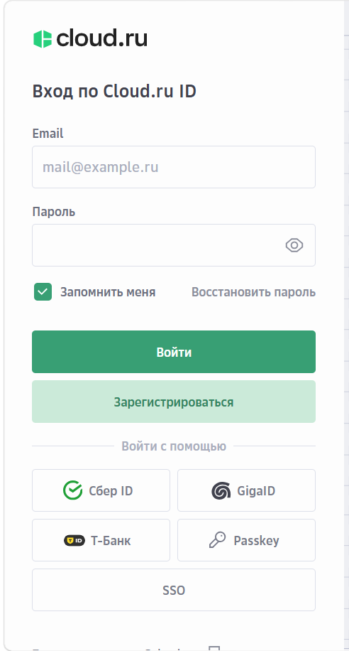
*Вход по Cloud.ru ID. Новый аккаунт - кнопка «Зарегистрироваться».*

**Шаг 2. Пополни баланс и открой «Пользователи».** На главной странице консоли справа - карточка
«Баланс»: нажми **«Пополнить баланс»** и положи 100–300 ₽. Без денег на счёте ИИ отвечать не будет.
Затем нажми **«Пользователи»**.

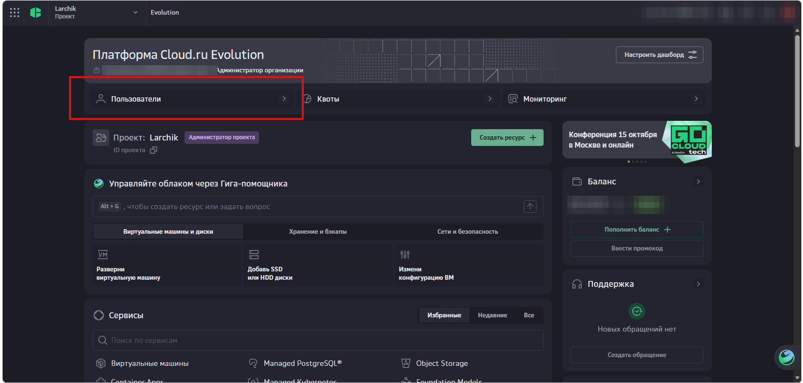
*Платформа Evolution: «Пользователи» - слева вверху, «Пополнить баланс» - в карточке «Баланс» справа.*

**Шаг 3. Перейди в «Сервисные аккаунты».** Это отдельный «пользователь» для программ: ключ
Larchik будет привязан к нему, а не к твоему личному входу.

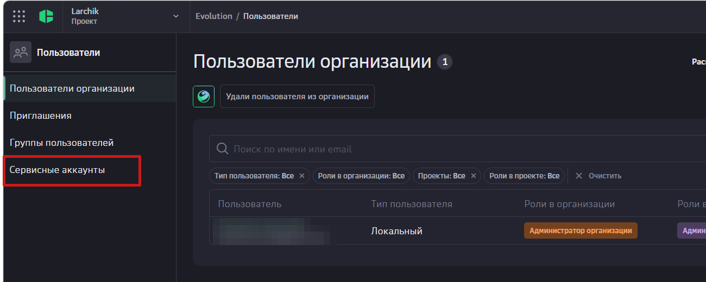
*Меню слева → «Сервисные аккаунты».*

**Шаг 4. Создай сервисный аккаунт.** Нажми **«Создать аккаунт»** справа вверху.

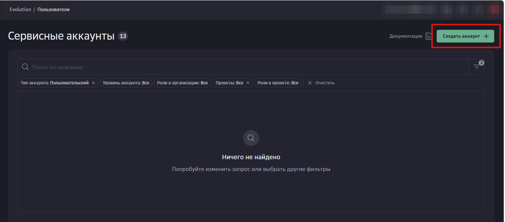
*Если аккаунтов ещё нет, список пустой - это нормально.*

**Шаг 5. Заполни данные аккаунта.** Название - например, `Larchik`, описание - любое.
Уровень аккаунта - **«Проект»**. Нажми **«Продолжить»**.

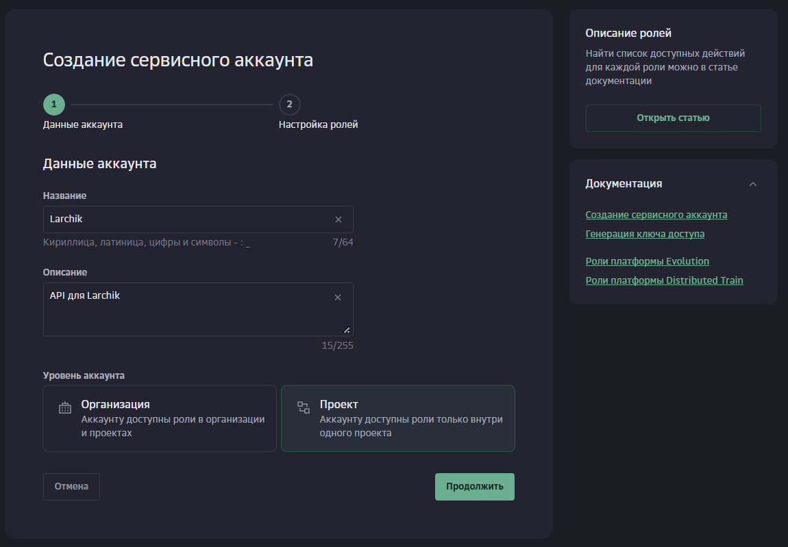
*Уровень «Проект»: аккаунт получит доступ только к одному проекту - так безопаснее.*

**Шаг 6. Выдай роль.** В поле «Роли внутри проекта» отметь только **«Пользователь проекта»** -
этого достаточно, чтобы ключ работал с моделями. Административные роли не нужны: чем меньше прав
у ключа, тем безопаснее, если он вдруг утечёт. Затем нажми кнопку внизу формы, чтобы создать аккаунт.

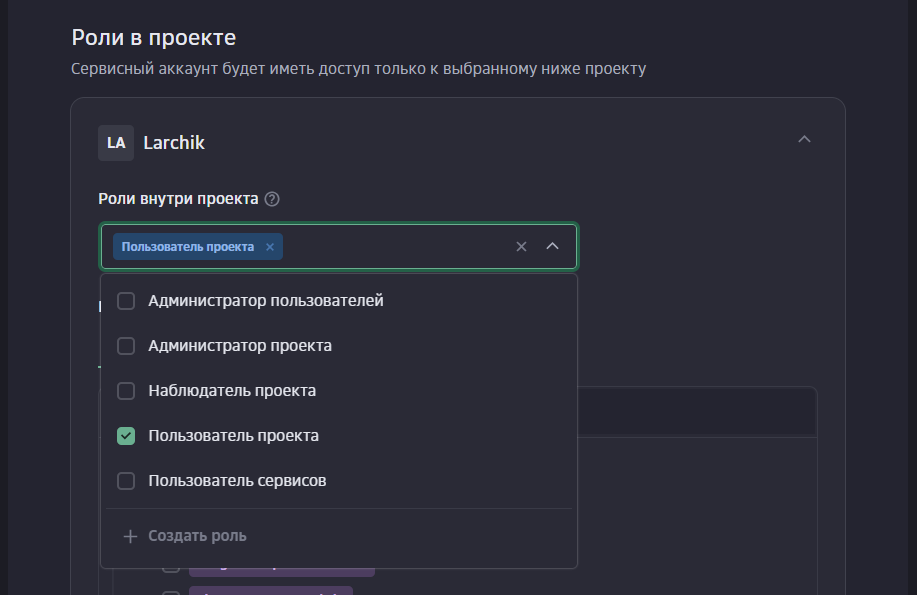
*Достаточно одной роли - «Пользователь проекта».*

**Шаг 7. Открой созданный аккаунт.** Он появится в списке со статусом «Активен» - нажми на его название.

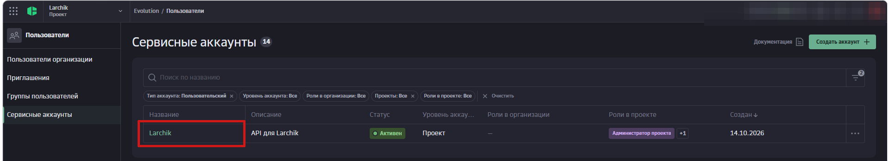
*Нажми на название аккаунта, чтобы открыть его настройки.*

**Шаг 8. Создай API-ключ.** В блоке «Учётные данные доступа» на вкладке **«API-ключи»** нажми
**«Создать API-ключ»**. Вкладка «Ключи доступа» не нужна: такой ключ Larchik не примет.

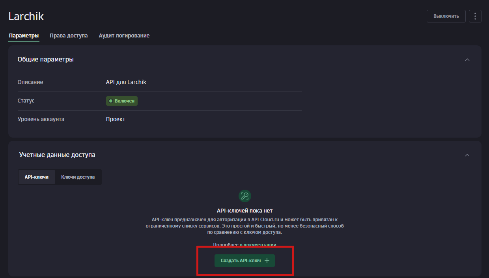
*Вкладка «API-ключи» → «Создать API-ключ».*

**Шаг 9. Настрой ключ.** Название и описание - любые. В поле **«Сервисы»** обязательно выбери
**Foundation Models** - без этого ключ не даст доступа к моделям. Поля «Адреса» оставь пустыми.
Нажми «Создать» и **сразу скопируй ключ**: cloud.ru показывает его только один раз.

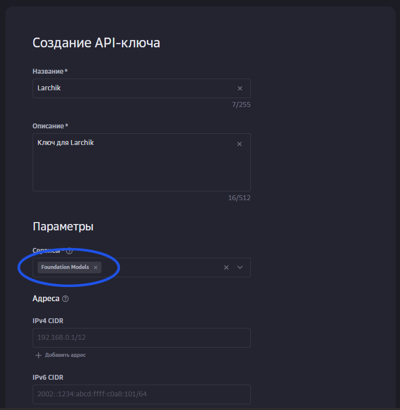
*Главное - сервис Foundation Models (обведён синим).*

**Шаг 10. Подключи в Larchik.** Настройки → ИИ → «Подключение» → провайдер **cloud.ru - много
моделей** → вставь ключ в поле «API-ключ» → **«Проверить и подключить»**. Модель по умолчанию -
GigaChat; кнопка «Список» покажет все модели платформы.

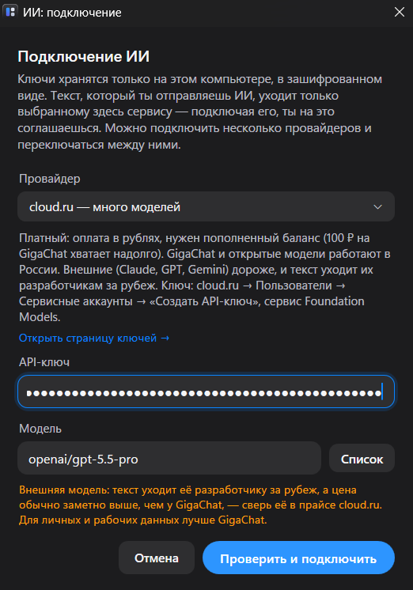
*Если выбрать внешнюю модель (здесь - GPT), Larchik предупредит, что текст уйдёт за рубеж и это дороже.*

> Ключ вставляй только в Larchik. Никому его не пересылай; если ключ утёк - удали его в карточке
> сервисного аккаунта и создай новый.

По умолчанию выбрана модель GigaChat. Кнопка «Список» покажет всё, что есть на платформе.
Модели с пометкой **«внешняя»** (Claude, GPT, Gemini) cloud.ru перепродаёт: текст уходит их
разработчику за рубеж, а цена обычно заметно выше - сверь её в прайсе cloud.ru.
Для личных и рабочих данных лучше GigaChat или открытые модели без пометки.

## Алиса AI - Яндекс

**Платный сервис** Yandex Cloud: оплата в рублях с платёжного аккаунта. Новым личным аккаунтам Яндекс даёт
**стартовый грант** - по [условиям Yandex Cloud](https://yandex.cloud/ru/docs/getting-started/usage-grant)
не менее 4 000 ₽ на 60 дней. Этого с запасом хватит, чтобы попробовать.

**Сколько это:** Алиса AI (`aliceai-llm`) ≈ 0,5 ₽ за 1 000 входных токенов и 1,2 ₽ за 1 000 выходных -
то есть обычный запрос стоит 1–3 ₽. YandexGPT Lite дешевле (≈ 0,2 ₽ за 1 000 токенов). Это заметно дороже,
чем GigaChat на cloud.ru. Актуальные цены - на странице [тарифов AI Studio](https://aistudio.yandex.ru/docs/ru/ai-studio/pricing).

### Пошагово

Займёт около 5 минут. Кнопки на скриншотах обведены красным, важные места - синим.

**Шаг 1. Войди в AI Studio.** Открой [aistudio.yandex.ru](https://aistudio.yandex.ru) и нажми **«Войти»**
справа вверху. Подойдёт обычный Яндекс ID. Если облака ещё нет, AI Studio предложит его создать.

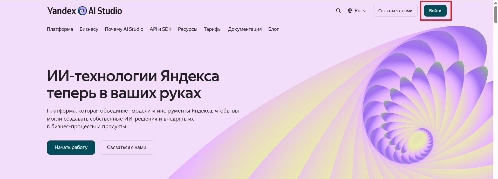
*Yandex AI Studio - кнопка «Войти» справа вверху.*

**Шаг 2. Проверь платёжный аккаунт.** Справа вверху, рядом с кнопкой ключа, виден баланс - значит,
платёжный аккаунт привязан и стартовый грант начислен. Если вместо баланса написано
«Платёжный аккаунт не привязан», нажми на надпись и создай или привяжи его. Без этого Яндекс
отклоняет запросы даже с верным ключом, а грант начисляется только после привязки.

**Шаг 3. Создай API-ключ.** Нажми **«Создать API-ключ»** справа вверху.

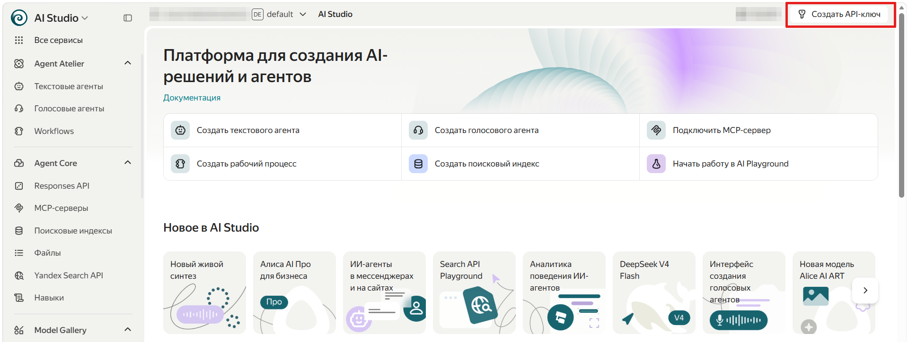
*Кнопка «Создать API-ключ» - справа вверху, рядом с балансом.*

**Шаг 4. Настрой ключ.** Описание - например, `Larchik`. Срок действия - на твой выбор:
«Бессрочно» удобнее, ограниченный срок безопаснее. Нажми **«Создать»** и **сразу скопируй
секретный ключ** - его показывают один раз.

Роли выставлять не нужно: Яндекс сам создаст сервисный аккаунт с минимальными правами для AI Studio.
Поменять их можно позже в Identity and Access Management, а все ключи видны по ссылке
«К списку API-ключей» - там же ненужный ключ можно удалить.

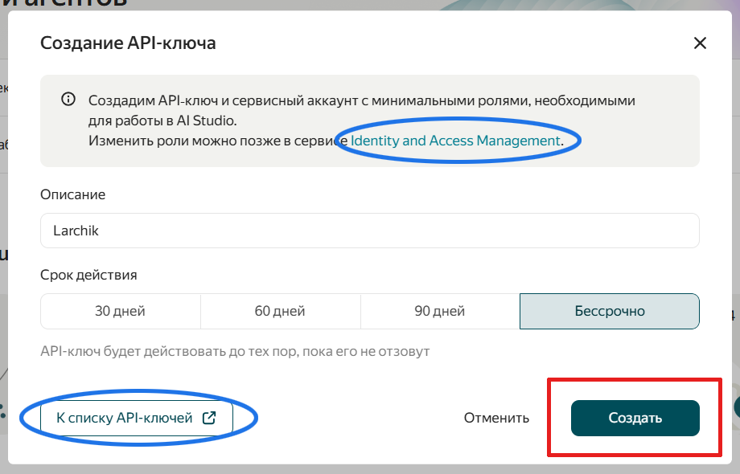
*Описание и срок действия → «Создать». Синим обведены управление ролями и список ключей.*

**Шаг 5. Скопируй ID каталога.** Вверху страницы рядом с названием каталога (обычно `default`)
нажми кнопку **«ID»** - идентификатор скопируется. Он начинается с `b1g…`.
Частая ошибка - взять ID организации (`bpf…`) или сервисного аккаунта (`aje…`): они не подойдут,
Larchik сразу об этом скажет.

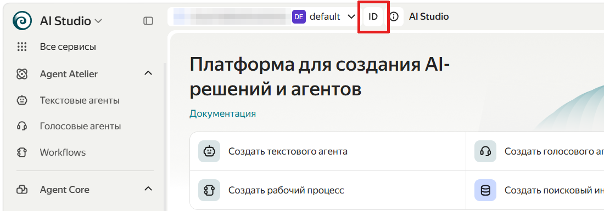
*Кнопка «ID» рядом с названием каталога копирует его идентификатор.*

**Шаг 6. Подключи в Larchik.** Настройки → ИИ → «Подключение» → провайдер **Алиса AI - Яндекс** →
вставь ID каталога и ключ → **«Проверить и подключить»**. Модель по умолчанию - Алиса AI
(`aliceai-llm`); кнопка «Список» покажет остальные модели AI Studio.

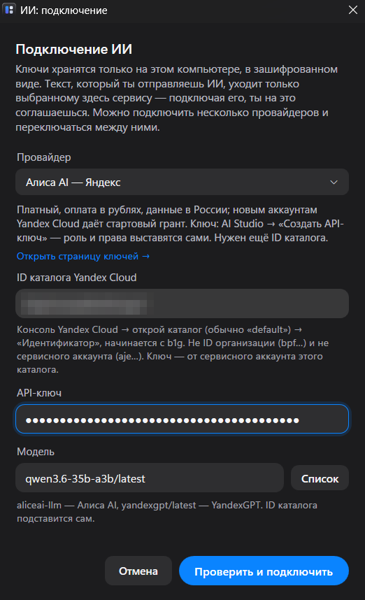
*ID каталога, ключ и модель. На скриншоте выбрана Qwen3.6 из «Списка».*

> Ключ вставляй только в Larchik и никому не пересылай. Если ключ утёк - удали его в списке
> API-ключей и создай новый.

**Если создаёшь ключ вручную в консоли Yandex Cloud** - роль и права задаются в разных местах:

- **Роль** даётся сервисному аккаунту, а не ключу: при создании сервисного аккаунта в поле «Роли в каталоге»
  или позже в каталоге → **«Права доступа»** → «Назначить роли». Нужна `ai.languageModels.user`
  (подходит и более широкая `ai.editor`).
- **Область действия** выбирается при создании API-ключа. В выпадающем списке ролей нет -
  там только области: отметь `yc.ai.foundationModels.execute` (можно добавить и `yc.ai.languageModels.execute`).

## DeepSeek

**Платный сервис**, оплата в долларах с баланса на сайте. Компания из Китая - текст уходит туда.
Проверь, примет ли сервис твою карту: с российскими картами зарубежные сервисы обычно не работают.

**Сколько это:** `deepseek-flash` ≈ $0.3 за 1 млн входных токенов и $1.2 за 1 млн выходных, ночью
и по выходным - вдвое дешевле. Пары долларов хватит надолго. Цены -
на [странице тарифов](https://api-docs.deepseek.com/quick_start/pricing).

### Пошагово

Займёт 3–5 минут. Кнопки на скриншотах обведены красным.

**Шаг 1. Войди или зарегистрируйся.** Открой [platform.deepseek.com](https://platform.deepseek.com).
Войти можно по почте, номеру телефона или через Google; новый аккаунт - ссылка **Sign up**.

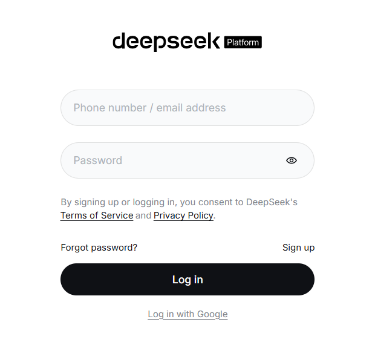
*Вход на DeepSeek Platform. Интерфейс на английском.*

**Шаг 2. Пополни баланс.** На странице **Usage** нажми **Top up** и пополни баланс на $2–5.
Здесь же видно, сколько потрачено: например, 13 запросов из Larchik обошлись в 3 цента.
Затем открой в меню слева **API keys**.

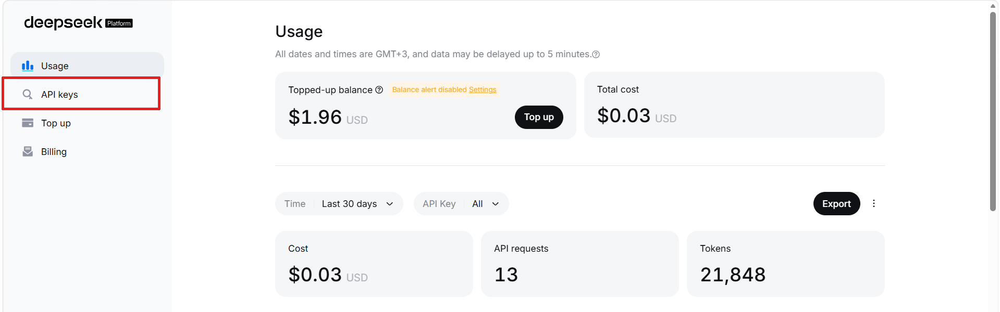
*Usage: баланс, кнопка Top up и расходы. Пункт «API keys» - в меню слева.*

**Шаг 3. Создай ключ.** Нажми **Create new API key**.

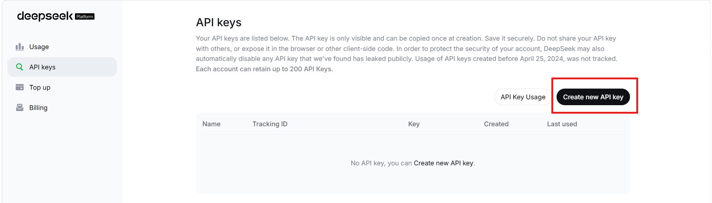
*Список ключей. DeepSeek показывает ключ целиком только один раз - при создании.*

**Шаг 4. Назови ключ.** Например, `Larchik` → **Create API key**. **Сразу скопируй ключ**
из следующего окна: потом его уже не посмотреть, только создать новый.

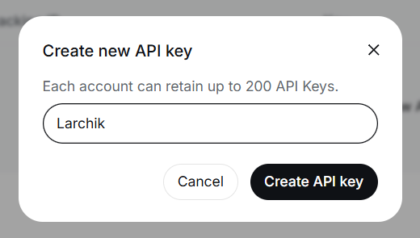
*Имя ключа - любое, оно нужно только тебе.*

**Шаг 5. Подключи в Larchik.** Настройки → ИИ → «Подключение» → провайдер **DeepSeek** →
вставь ключ → **«Проверить и подключить»**. Модель по умолчанию - `deepseek-flash`:
она быстрая и дешёвая. `deepseek-v4-pro` умнее, но дороже.

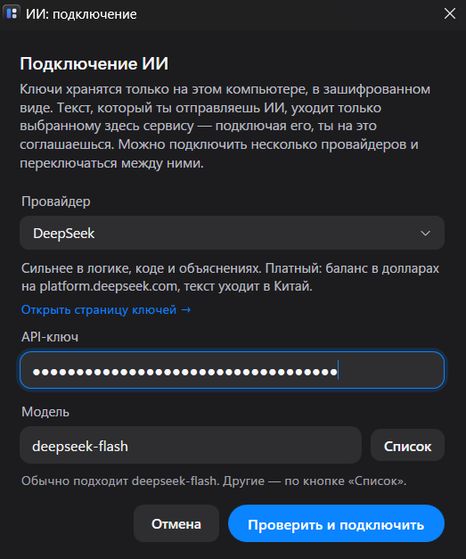
*Провайдер DeepSeek, ключ и модель deepseek-flash.*

> DeepSeek может сам отключить ключ, если обнаружит его в открытом доступе. Вставляй ключ только
> в Larchik и никому не пересылай.

## Своя модель на компьютере

**Бесплатно**, и текст не уходит с компьютера. Но модели требовательны: для нормальной скорости
нужно 16 ГБ памяти и желательно видеокарта. Ответы небольших моделей заметно слабее облачных.

1. Установи [Ollama](https://ollama.com) и скачай модель, например `ollama pull qwen2.5:7b`.
2. В Larchik: провайдер **«Свой адрес»** → адрес `http://localhost:11434/v1` → «Список» →
   выбери модель. Ключ не нужен.

---

**Не получилось?** Larchik показывает понятную причину под кнопкой «Проверить и подключить»
(неверный ключ, пустой баланс, нет модели). Если причина непонятна -
[напиши нам](https://belart16.github.io/larchik/feedback.html) - без регистрации.
